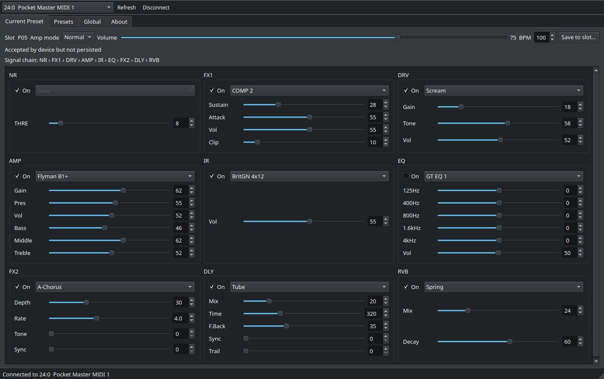

# Sonicake Manager for Linux

Open-source desktop manager for [Sonicake](https://www.sonicake.com/) guitar processors — for Linux, built on a clean, documented implementation of the device's published SysEx payload format and public protocol notes. No firmware internals involved.

The goal is a fully native Linux experience for editing Sonicake processors: a PySide6 GUI, a scriptable CLI, and a reusable Python protocol library.

## Features (implemented)



- USB-MIDI connection through the ALSA sequencer (ctypes over `libasound` — no compiled dependencies, works alongside PipeWire/JACK)
- Device auto-discovery (Pocket Master and Q-series by name), or `SONICAKE_MIDI_ADDRESS=client:port`
- Preset number, 100 preset names (50 user + 50 factory), current preset state, global settings
- State decode: volume, BPM, module on/off, selected effects, per-module parameters, signal chain, footswitch assignments
- Edit the edit buffer: module on/off, effect selection, parameters, chain order, preset volume, amp mode, footswitch assignment
- Save the buffer to any of the 50 user slots
- Export the current edit buffer to JSON and replay it into the buffer (`export` / `import-preset --yes`)
- PySide6 GUI (current-preset editor, preset browser, global settings) with English and Portuguese translations
- CLI (`sonicake-manager`) for scripting and debugging
- Packaged effect/parameter data tables; CRC-verified frames

## Not yet implemented

- IR upload and clone profile (NAM) management
- Full backup/restore of all 100 presets (current-preset JSON export/import is implemented)
- BLE-MIDI transport (UI is prepared for it; ALSA sequencer only today)
- Factory preset writing (read/select only)

Contributions welcome — see [docs/architecture.md](docs/architecture.md).

## Supported devices

See [docs/devices.md](docs/devices.md). Developed and verified against a **Pocket Master**.

## Requirements

- Linux with ALSA (any distribution)
- Python ≥ 3.11
- `libasound` (always present on ALSA systems)

## Install from source

```bash
python3 -m venv .venv
.venv/bin/pip install .
.venv/bin/sonicake-manager-gui    # desktop app
.venv/bin/sonicake-manager --help # CLI
```

The GUI starts disconnected; pick your device in the toolbar combo (auto-detected) or set `SONICAKE_MIDI_ADDRESS=24:0`.

CLI quick reference:

```bash
sonicake-manager list                 # list sequencer ports (* = device)
sonicake-manager info                 # current preset slot
sonicake-manager state                # full state dump, decoded (JSON)
sonicake-manager names                # list the 100 preset names
sonicake-manager select P03           # select user preset 3
sonicake-manager set DRV 0 40         # parameter: module, algId, value
sonicake-manager set-module DRV on    # toggle a module
sonicake-manager save 1 --name TONE   # save edit buffer to user slot 1
```

## Flatpak

A Flatpak manifest lives in [`packaging/flatpak/`](packaging/flatpak/) and uses the `io.qt.PySide.BaseApp` base (Qt 6.11 / KDE Platform), so build times stay small and no PySide6 sources are compiled. Build locally with:

```bash
flatpak-builder --user --install --force-clean build-dir packaging/flatpak/io.github.fl4sh.sonicake_manager.yml
```

USB-MIDI needs `/dev/snd/seq`; Flatpak has no dedicated sound-only device permission, so the manifest uses `--device=all`. The app does not request host filesystem access. This is experimental; expect to iterate on finish-args. Other formats (AppImage, RPM, DEB) are planned.

## Protocol and data tables

The wire format (uniform nibble expansion, CRC-8/SMBUS, BLE-style `8080` header) is documented in [docs/protocol.md](docs/protocol.md) and [docs/protocol-requests.md](docs/protocol-requests.md). Preset JSON export/import is described in [docs/preset-files.md](docs/preset-files.md). The effect/parameter tables in `src/sonicake_manager/data/` are packaged JSON derived from the documented payload catalog.

## License

MIT. See [LICENSE](LICENSE).

This project is independent and not affiliated with Sonicake.
